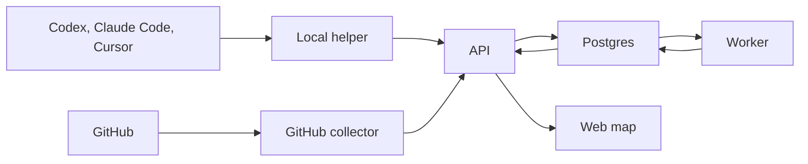

<p align="center">
  
</p>

<h1 align="center">Contour</h1>

<p align="center">
  A feature map built from GitHub and local coding-agent sessions.
</p>

<p align="center">
  =22-3c873a?style=flat-square" alt="Node.js >= 22" />
  
</p>

<p align="center">
  <a href="#overview">Overview</a> •
  <a href="#features">Features</a> •
  <a href="#architecture">Architecture</a> •
  <a href="#project-structure">Project structure</a> •
  <a href="#getting-started">Getting started</a> •
  <a href="#how-the-map-is-built">How the map is built</a>
</p>

Contour watches a GitHub repository and the sessions from Codex, Claude Code, and Cursor, then groups that work into features and work items. The web app is the map: what is being built, what state it is in, and what it depends on.

> [!TIP]
> You can look around without an OpenAI key. Sign in once, then run `npm run demo:seed -w @apm/api -- your-github-username`. That adds a sample project, `demo/shop-app`.

## Overview

A pull request, a CI run, and an agent session are three records of the same work. Contour stores them as events, then a background worker turns those events into one map.

- The **web app** is where you sign in, connect a repository, and read the map.
- The **API** accepts sign-in, repository connections, session uploads, and GitHub webhooks.
- The **local helper** runs on your computer, reads agent logs, and uploads new session text.
- The **GitHub collector** checks repository access and turns webhooks into normalized events. The API and the worker call it. It does not run on its own.
- The **worker** reads stored events and writes the map. Facts are applied before any model call.
- **Postgres**, through Supabase, stores the events, the map, and GitHub login.

## Features

- **One map for a repository.** Features, work items, states, and dependencies, built from GitHub and from local agent sessions.
- **Three agents.** Codex, Claude Code, and Cursor. The helper scans their log folders and uploads only what changed.
- **GitHub as the source of state.** An open pull request means in review, a draft means in progress, and work counts as merged only when its pull requests say so. An agent saying "done" never marks anything merged.
- **Corrections you keep.** Rename, move, merge, split, or dismiss a dependency. Later analysis does not undo that decision.
- **A sample project.** Seed `demo/shop-app` and walk the map without a model key.

## Architecture



The helper uploads session text. GitHub reaches the API through a webhook. The API stores both and answers immediately. The worker later turns stored events into the map. The browser only reads that map.

## Project structure

| Path | Role |
|---|---|
| [`apps/web`](apps/web) | React map |
| [`apps/api`](apps/api) | Express HTTP routes |
| [`apps/worker`](apps/worker) | Background jobs that turn stored events into the map |
| [`apps/github-collector`](apps/github-collector) | Webhook normalization, enrichment, and refresh |
| [`apps/local-collector`](apps/local-collector) | Local helper. The Mac menu-bar app is `src/mac/` |
| [`packages/core`](packages/core) | Database, map processing, and logic shared by the API and the worker |
| [`packages/shared`](packages/shared) | Shared schemas and types |
| [`supabase`](supabase) | Local Postgres and Auth |

Each app folder has its own README for the flow and the files inside it.

## Getting started

### Prerequisites

- [Node.js 22](https://nodejs.org/) or newer
- [Docker Desktop](https://www.docker.com/products/docker-desktop/), running, for `supabase start`
- A GitHub OAuth app for local login
- A GitHub App for pull request and Actions webhooks

### Install and run

Copy `.env.example` to `.env` and fill the values after `supabase status`. Do not commit `.env`.

```bash
npm install
npx supabase start
npm run typecheck
npm test
npm run dev:api
npm run dev:web
npm run dev:worker
npm run dev:helper
```

Open `http://127.0.0.1:5173`.

`npm test` needs `DATABASE_URL` and the migrations in `supabase/migrations`. `supabase start` does both. Tests that talk to GitHub are mocked.

> [!IMPORTANT]
> `GITHUB_WEBHOOK_SECRET` must be a non-empty string. The API exits on startup when it is missing. Connecting a repository also requires `GITHUB_APP_ID` and `GITHUB_APP_PRIVATE_KEY`. A private key in `.env` can use literal `\n` escapes.

Public tables have row level security enabled and no policies. The API uses `DATABASE_URL` (the database owner). Do not put the service role key in the browser.

### Connect the helper

Start the helper with `npm run dev:helper`, then open **Settings → Local helper** and click **Connect this computer**. The site creates a one-time code and hands it to the helper at `http://127.0.0.1:47321`. Folder choices for which sessions to upload live on that same page.

### This release

You can sign in with GitHub, connect repositories you can write to, pair a helper, and read the map. Each repository belongs to one project. The server uses one OpenAI key, `OPENAI_API_KEY`, to group work.

> [!NOTE]
> Sharing a project, and saving a personal model key, are left out of this release. That code stays on the `full-product` branch. Without the server key, GitHub and session facts are still stored and pull request states still update.

## How the map is built

The helper keeps per-session checkpoints and an upload queue in SQLite. About every 30 seconds it scans `~/.codex/sessions`, `~/.claude/projects`, and `~/.cursor/projects`. Settings can point an agent at a different folder. That choice stays on this computer.

The API stores each GitHub delivery and answers GitHub before calling the GitHub API. The worker then loads the current pull request or workflow run. Every 5 seconds it turns new events into facts, then asks the model to group evidence that has settled. Facts never wait for the model. Pull request and CI facts only enter through the verified webhook and the refresh.

The map is served at:

| Route | Returns |
|---|---|
| `GET /projects/:id/graph` | Features, work items, dependencies, and evidence still waiting |
| `GET /projects/:id/graph/revision` | The revision number, for cheap polling |
| `GET /projects/:id/work-items/:workItemId` | Pull requests, CI, evidence, contributors, and history |
| `GET /projects/:id/features/:featureId` | The feature's work items, contributors, and history |
| `POST /projects/:id/corrections` | `rename`, `move`, `merge`, `split`, or `dismiss` |

To check grouping quality with a real model, set `OPENAI_API_KEY` and run:

```bash
npm run eval -w @apm/api
```

`OPENAI_MODEL` defaults to `gpt-5-nano`. The sample project is deleted afterwards unless you pass `-- --keep`.

### Run it on a server

`npm run dev:api` and `npm run dev:worker` stay on your machine and run TypeScript directly. On a server, compile first:

```bash
npm run build:server
npm start --workspace @apm/api
npm start --workspace @apm/worker
```

`npm start` listens on `PORT` (otherwise `API_PORT`, otherwise 4000). The API and the worker both stop on `SIGTERM`.

On Railway, the `api` and `worker` services take their build and start commands from `.railway/railway.ts`. After changing that file, run `railway config plan`, then `railway config apply`. Secrets stay in the Railway dashboard.

The web app bakes `VITE_SUPABASE_URL`, `VITE_SUPABASE_ANON_KEY`, and `VITE_API_URL` in at build time. The hosted Mac app is published as `Contour-Mac.zip` on the GitHub release `mac-helper-v1.0.0`. Build it with `npm run build:mac --workspace @apm/local-collector`.

Required server environment variables: `DATABASE_URL`, `GITHUB_WEBHOOK_SECRET`, `GITHUB_APP_ID`, `GITHUB_APP_PRIVATE_KEY`, `SUPABASE_URL` (and `SUPABASE_JWT_SECRET` when tokens are still HS256), `APM_SECRETS_KEY`, and `WEB_ORIGIN`. `OPENAI_API_KEY` is the server-wide model key.

Point the GitHub App webhook at `https://<your-api>/github/webhook`. In the Supabase dashboard, add the site address to the redirect URLs, and add that same address as the GitHub OAuth callback.
