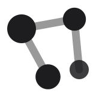
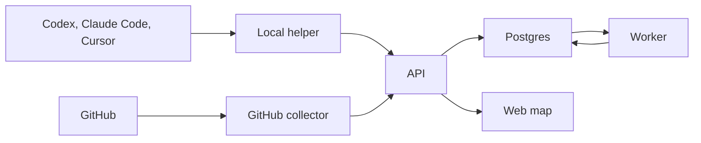

<p align="center">
  
</p>

# [Contour](https://contourmaps.vercel.app)

A roadmap of your project, built automatically from GitHub activities and local coding-agent sessions.

<p align="center">
  
  
  
  
  
  
  
  
  
  
  
  
  
  
  
  
</p>

## The problem

A pull request, a CI run, and a coding-agent session are three records of the same work, and they live in different places. Contour puts them on one map automatically: what is being built, what state it is in, and what it depends on.

## How it fits together



The helper runs on your computer. About every 30 seconds it scans `~/.codex/sessions`, `~/.claude/projects`, and `~/.cursor/projects`, keeps a checkpoint per session in SQLite, and uploads only new text.

GitHub reaches the API through a webhook. The API stores the delivery and answers immediately. The worker then loads the current pull request or workflow run and writes facts: pull requests, reviews, workflow runs, and evidence. Facts never wait for the model. When a server OpenAI key is set, the model groups evidence that has settled into the map. The browser only reads that map.

## What you can do

Sign in with GitHub, connect a repository you can write to, and pair the helper on this computer. Each repository belongs to one project.

A feature is a card. Its work items come from sessions and pull requests. An open pull request means in review, a draft means in progress, and work counts as merged only when its pull requests say so. An agent saying "done" never marks anything merged. Open a card for its work items, then a work item for the pull requests, CI, session excerpts, and history behind it.

You can rename a title, move cards around on the map, and merge features or work items.

## Project structure

| Path | Role |
|---|---|
| [`apps/web`](apps/web) | React map |
| [`apps/api`](apps/api) | Express routes for sign-in, uploads, webhooks, and the map |
| [`apps/worker`](apps/worker) | Turns stored events into the map |
| [`apps/github-collector`](apps/github-collector) | Webhook normalization, enrichment, and refresh |
| [`apps/local-collector`](apps/local-collector) | Local helper. The Mac menu-bar app is `src/mac/` |
| [`packages/core`](packages/core) | Database and map processing shared by the API and the worker |
| [`packages/shared`](packages/shared) | Shared schemas and types |
| [`supabase`](supabase) | Local Postgres and Auth |

Each app folder has its own README for the flow and the files inside it.

## Run it locally

- [Node.js 22](https://nodejs.org/) or newer
- [Docker Desktop](https://www.docker.com/products/docker-desktop/), running, for `supabase start`
- A GitHub OAuth app for login, and a GitHub App for pull request and Actions webhooks

Copy `.env.example` to `.env` and fill the values after `supabase status`. Do not commit `.env`.

```bash
npm install
npx supabase start
npm run typecheck
npm test
npm run dev:api
npm run dev:web
npm run dev:worker
npm run dev:helper
```

Open `http://127.0.0.1:5173`. In **Settings → Local helper**, click **Connect this computer**. The site hands a one-time code to the helper at `http://127.0.0.1:47321`. That same page is where you choose which project folders to upload.

`npm test` needs `DATABASE_URL` and the migrations in `supabase/migrations`. `supabase start` does both. Tests that talk to GitHub are mocked.

> [!IMPORTANT]
> `GITHUB_WEBHOOK_SECRET` must be a non-empty string. The API exits on startup when it is missing. Connecting a repository also requires `GITHUB_APP_ID` and `GITHUB_APP_PRIVATE_KEY`. A private key in `.env` can use literal `\n` escapes.

> [!TIP]
> To look around without an OpenAI key of your own, sign in once and run `npm run demo:seed -w @apm/api -- your-github-username`. That adds `demo/shop-app`. On the hosted app, grouping uses one server key so people can try the map.

## Scope

This release runs on a Mac. It reads Codex, Claude Code, and Cursor, and it uses one server OpenAI key so visitors can try grouping without bringing their own.

Later:

- **Multiplayer.** Share a project with other people.
- **Your own API key.** Save a personal model key instead of using the server key.
- **Windows.** Run the helper on Windows.
- **More coding agents.** Read sessions from agents beyond Codex, Claude Code, and Cursor.

## License

[MIT](LICENSE).
