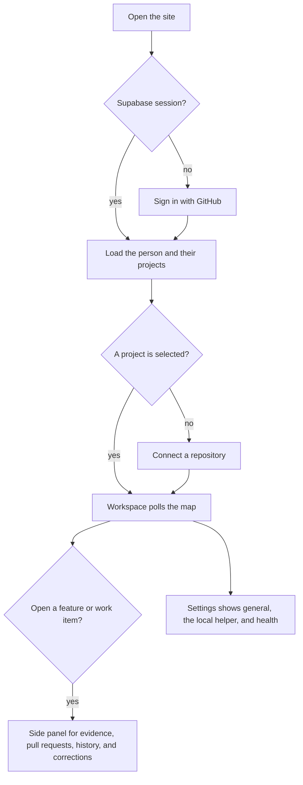

# Web

The browser app for Contour. A person signs in, connects one GitHub repository, and reads the feature map. Map processing and storage live in `packages/core`. This folder only renders them.

## Structure

This release hides the members and model tabs. `src/release.ts` keeps that source in the tree for a later release.

## Files

- `package.json` declares the `@apm/web` package, Vite, and React.
- `vite.config.ts` builds the site from `src` and writes `dist`. Addresses such as `VITE_API_URL` are baked in at build time.
- `src/index.html` is the page Vite serves. `src/main.tsx` starts the React app.
- `src/App.tsx` holds the session, loads projects, and shows sign-in, onboarding, or the workspace.
- `src/supabase.ts` creates the Supabase client used for GitHub sign-in.
- `src/api.ts` calls the API and the local helper on this computer.
- `src/format.ts` labels work-item states, agents, and times.
- `src/attribution.ts` compares GitHub logins.
- `src/helpers.ts` joins class names and provides a ticking clock for relative times.
- `src/release.ts` turns project sharing and personal model keys off for this release.
- `src/pages/` is sign-in, onboarding, the workspace, settings, and the Mac helper download.
- `src/map/` draws the feature map.
- `src/panel/` shows one feature or work item, including rename, move, merge, and split.
- `src/ui/` is the shared buttons, marks, menus, and toasts.
