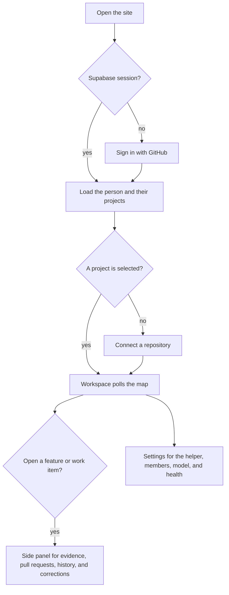

# Web

The browser app for Contour. A person signs in, connects one GitHub repository, and reads the feature map. Map processing and storage live in `packages/core`. This folder only renders them.

## Structure

## Files

- `package.json` declares the `@apm/web` package, Vite, and React.
- `vite.config.ts` builds the site. Addresses such as `VITE_API_URL` are baked in at build time.
- `src/index.html` is the page Vite serves. `src/main.tsx` starts the React app.
- `src/App.tsx` holds the session, loads projects, and shows sign-in, onboarding, or the workspace.
- `src/api.ts` calls the API and the local helper on this computer.
- `src/supabase.ts` creates the Supabase client used for sign-in.
- `src/components/Workspace.tsx` is the map, the side panel, and settings.
- `src/components/map/` draws the feature map.
- `src/components/panel/` shows one feature or work item.
- `src/components/settings/SettingsDialog.tsx` is project settings, including pairing the local helper.
- `src/components/corrections/Dialogs.tsx` covers rename, move, merge, and split.
